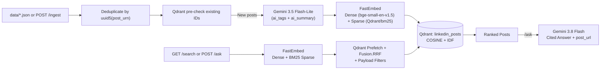

# LinkedIn Saved Posts Hybrid Search & RAG Service — Implementation Plan

## Goal Description
Build a local-first, Cloud Run–ready Hybrid Search & RAG service for LinkedIn saved posts exported as JSON from **LinkedIn Saved Post Hero**. The service ingests exported JSON files into Qdrant using both dense semantic embeddings and sparse BM25 vectors (via FastEmbed), enriches each post with structured AI tags and summaries using `gemini-3.5-flash-lite`, exposes hybrid RRF search and cited RAG Q&A (`gemini-3.8-flash`) via FastAPI, and packages cleanly in a multi-stage `uv` Docker image.

---

## User Review Required

> [!IMPORTANT]
> **Package & Module Layout (`src/*.py` vs `src/linkedin_saved_rag/`)**
> The repository currently has a `uv_build` placeholder at `src/linkedin_saved_rag/__init__.py`, while `prompts/START.md` specifies `src/db.py`, `src/enrich.py`, `src/ingest.py`, `src/main.py` and CLI invocation `uv run python -m src.ingest data/`.
> - **Plan**: Place `db.py`, `enrich.py`, `ingest.py`, `main.py`, and `__init__.py` directly under `src/` (removing the unused `src/linkedin_saved_rag/` placeholder and adjusting `pyproject.toml` if needed) so `uv run python -m src.ingest data/` and `uvicorn src.main:app` work out of the box.

> [!NOTE]
> **Data Findings & Edge Cases (`data/*.json`)**
> Inspecting the 29 staged files in `data/*.json` revealed:
> - **5,820 total entries** collapsing to **4,532 unique `post_urn`s** (significant overlap across exports, confirming pre-check deduplication is essential).
> - **19 entries** have empty/whitespace `post_text` (e.g., media-only posts). For these, we will fall back to `post_image_alt` (if present) or skip Gemini enrichment and store empty tags/summary rather than failing ingestion.
> - Posts include both English and Spanish content. The plan defaults to `BAAI/bge-small-en-v1.5` (384-dim, fast, low memory for Cloud Run) for dense embeddings; if strong cross-lingual retrieval is desired, we can swap to `intfloat/multilingual-e5-small` (384-dim).

> [!WARNING]
> **Missing Dependency for `POST /ingest`**
> FastAPI's `UploadFile` requires `python-multipart`, which is not yet in `pyproject.toml`. We will add `python-multipart` via `uv add python-multipart` during implementation.

---

## Proposed Directory Structure

```text
linkedin-saved-rag/
├── .dockerignore
├── .envrc                  # (existing, gitignored)
├── .gitignore              # (existing)
├── .pre-commit-config.yaml # (existing: gitleaks + ruff)
├── Dockerfile
├── pyproject.toml
├── uv.lock
├── data/                   # (existing, 29 staged JSON exports, gitignored)
├── prompts/
│   └── START.md
├── src/
│   ├── __init__.py
│   ├── db.py               # Qdrant client, collection/index setup, hybrid RRF search
│   ├── enrich.py           # Gemini 3.5 Flash-Lite structured tagging & summarization
│   ├── ingest.py           # CLI + shared batch ingestion with URN deduplication
│   └── main.py             # FastAPI app (/health, /ingest, /search, /ask)
└── tests/
    ├── test_enrich.py
    ├── test_ingest.py
    └── test_api.py
```

---

## Architecture Overview



---

## Proposed Changes

### 1. Project Configuration & Dependencies
#### [MODIFY] `pyproject.toml`
- Add `python-multipart` for FastAPI file uploads (`POST /ingest`).
- Ensure `src` layout works smoothly with `uv run python -m src.ingest`.
- Remove unused `src/linkedin_saved_rag/__init__.py` placeholder.

---

### 2. Qdrant Database Layer
#### [NEW] `src/db.py`
Responsibilities:
- Initialize `QdrantClient` from `QDRANT_URL` (default `http://localhost:6333`) and optional `QDRANT_API_KEY` (`os.environ.get("QDRANT_API_KEY") or None`).
- Define collection `linkedin_posts` with:
  - Named dense vector `"dense"`: `VectorParams(size=384, distance=Distance.COSINE)`
  - Named sparse vector `"sparse"`: `SparseVectorParams(modifier=Modifier.IDF)`
- Create payload indexes idempotently before ingestion:
  - `author_name` (`PayloadSchemaType.KEYWORD`)
  - `ai_tags` (`PayloadSchemaType.KEYWORD`)
  - `has_image` (`PayloadSchemaType.BOOL`)
  - `is_company_post` (`PayloadSchemaType.BOOL`)
- Provide FastEmbed model loaders (cached singletons):
  - Dense: `TextEmbedding("BAAI/bge-small-en-v1.5")`
  - Sparse: `SparseTextEmbedding("Qdrant/bm25")`
- Provide `get_existing_ids(client, ids: list[str]) -> set[str]` using `client.retrieve(...)` in chunks (with `with_payload=False, with_vectors=False`) to check which deterministic UUIDs already exist in Qdrant.
- Provide `hybrid_search(client, query: str, limit: int = 10, author_name: str | None = None, ai_tags: list[str] | None = None)` using `client.query_points(...)` with two `Prefetch` queries (`using="dense"` and `using="sparse"`) fused via `models.FusionQuery(fusion=models.Fusion.RRF)`, and optional `models.Filter(must=[...])` for `author_name` (`MatchValue`) and `ai_tags` (`MatchAny`).

---

### 3. Structured AI Enrichment
#### [NEW] `src/enrich.py`
Responsibilities:
- Define Pydantic output model:
  ```python
  class PostEnrichment(BaseModel):
      ai_tags: list[str] = Field(description="3 to 5 normalized lowercase topic tags")
      ai_summary: str = Field(description="1 to 2 sentence concise summary of the post")
  ```
- Initialize `google.genai.Client()` (uses `GEMINI_API_KEY` from environment).
- Call `client.models.generate_content` with `model="gemini-3.5-flash-lite"`, `response_mime_type="application/json"`, and `response_schema=PostEnrichment`.
- Normalize returned `ai_tags`: lowercase, strip whitespace, deduplicate while preserving order, clamp to 3–5 tags.
- Handle empty `post_text` gracefully (use `post_image_alt` if available, otherwise return `PostEnrichment(ai_tags=[], ai_summary="")` without wasting an API call).

---

### 4. Ingestion Pipeline & CLI
#### [NEW] `src/ingest.py`
Responsibilities:
- Deterministic ID helper:
  ```python
  def make_point_id(post_urn: str) -> str:
      return str(uuid.uuid5(uuid.NAMESPACE_URL, post_urn))
  ```
- `ingest_records(records: list[dict], ...) -> dict[str, int]`:
  1. Validate each record has `post_urn` (count invalid records in `failed`).
  2. Deduplicate in-memory across files/records by `post_urn` (count duplicates in `skipped`).
  3. Pre-check existing IDs in Qdrant via `get_existing_ids(...)` and skip already-ingested posts **before** calling Gemini (count in `skipped`).
  4. For new posts:
     - Call `enrich_post(...)` (with bounded concurrency or sequential + retry/backoff on transient rate limits, catching per-post failures into `failed` so one bad post does not abort the batch).
     - Build embedding text: `post_text` + `ai_summary` + `ai_tags` (falling back to `post_image_alt` if `post_text` is empty).
     - Compute dense and sparse BM25 vectors via FastEmbed in batches.
     - Upsert `PointStruct`s to Qdrant with full metadata payload (`post_urn`, `post_url`, `author_name`, `author_headline`, `post_text`, `ai_tags`, `ai_summary`, `has_image`, `has_video`, `is_company_post`, `post_image_alt`, `posted_time`, `connection_degree`).
  5. Return `{"ingested": ..., "skipped": ..., "failed": ...}`.
- CLI entrypoint (`if __name__ == "__main__":`):
  - Accepts a path to a single `.json` file or a directory (globbing `*.json` sorted), e.g.:
    `uv run python -m src.ingest data/`
  - Supports optional `--limit` / `--dry-run` flags for safe local testing before ingesting all 4,532 unique posts.

---

### 5. FastAPI Service
#### [NEW] `src/main.py`
Responsibilities:
- FastAPI `lifespan` context manager ensures Qdrant collection & payload indexes exist and warms up FastEmbed models.
- Endpoints:
  - `GET /health`: Returns `{"status": "ok"}`.
  - `POST /ingest`: Accepts `file: UploadFile = File(...)`, parses JSON list of posts, runs `ingest_records(...)`, returns `IngestResponse(ingested, skipped, failed)`.
  - `GET /search`: Query params `q: str`, `limit: int = 10`, `author_name: str | None = None`, `ai_tags: list[str] | None = Query(default=None)`. Returns list of matched posts with `score` and payload fields.
  - `POST /ask`: Request body `AskRequest(query: str, top_k: int = 5, author_name: str | None = None, ai_tags: list[str] | None = None)`.
    - Runs hybrid search for `top_k` posts.
    - Prompts `gemini-3.8-flash` with the retrieved posts (including `author_name`, `ai_summary`, `post_text`, and `post_url`) instructing it to synthesize a helpful answer with inline markdown citations linking to each `post_url`.
    - Returns `AskResponse(answer: str, sources: list[SearchResult])`.

---

### 6. Cloud Run Packaging
#### [NEW] `Dockerfile`
- Multi-stage build using `ghcr.io/astral-sh/uv:python3.11-bookworm-slim`:
  - **Builder stage**: Copy `pyproject.toml` and `uv.lock`, run `uv sync --frozen --no-dev --no-install-project`, then copy `src/` and install project.
  - **Runtime stage**: `python:3.11-slim-bookworm`, copy `.venv` and `src/` from builder, set `PATH="/app/.venv/bin:$PATH"`, expose `8080`, run `uvicorn src.main:app --host 0.0.0.0 --port ${PORT:-8080}`.
  - Optionally pre-download FastEmbed models during build (or document `FASTEMBED_CACHE_PATH`) to minimize Cloud Run cold-start latency.

#### [NEW] `.dockerignore`
- Exclude `.git`, `.venv`, `.envrc`, `.direnv`, `data/`, `qdrant_storage/`, `prompts/`, `tests/`, `__pycache__/`, `*.pyc`.

---

## Verification Plan

### Automated Tests
Unit & API tests (mocking external Gemini API and using in-memory Qdrant `:memory:` or mocked client):
```bash
uv run pytest
uv run ruff check .
uv run ruff format --check .
```
Tests will cover:
1. Deterministic `uuid5` generation and cross-file / Qdrant pre-check deduplication (verifying Gemini is NOT called for already-ingested URNs).
2. `enrich.py` structured output parsing and tag normalization.
3. FastAPI endpoints (`GET /health`, `POST /ingest`, `GET /search`, `POST /ask`) via `TestClient`.

### Local End-to-End Verification
1. Start local Qdrant (already running on `http://localhost:6333`).
2. Run CLI ingestion on a small sample (e.g., single file or `--limit 10`):
   ```bash
   uv run python -m src.ingest data/linkedin-saved-posts-2026-11-25.json --limit 10
   ```
3. Re-run the same command to verify `skipped` equals 10 and `ingested` equals 0 (zero Gemini calls).
4. Start FastAPI locally:
   ```bash
   uv run uvicorn src.main:app --reload --port 8080
   ```
5. Test `/search` and `/ask` against the ingested posts via `curl` or `/docs`.
6. Verify Docker build:
   ```bash
   docker build -t linkedin-saved-rag .
   ```
